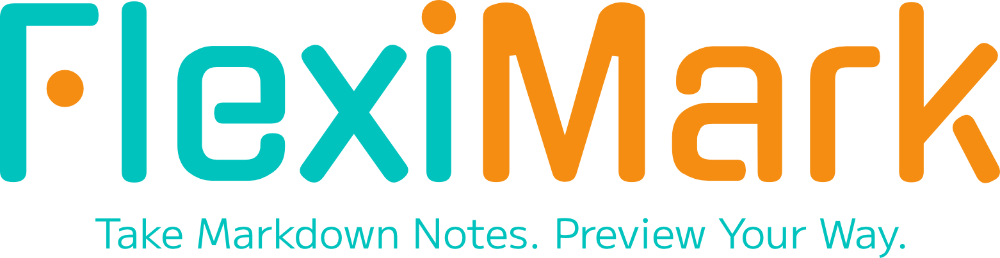

<div align="center">
  
  <h1>FlexiMark</h1>
  <p>Markdown previews and note workflows for VS Code, Zed and the browser.</p>
</div>


FlexiMark uses a shared native runtime for parsing, language features, safe HTML
rendering and workspace operations. VS Code offers embedded and browser previews;
Zed uses the browser preview and standard editor navigation.

## Features

- Live previews for workspace files, standalone Markdown and unsaved documents.
- Source-to-preview and preview-to-source navigation with stable document nodes.
- GFM tables and task lists, admonitions and alerts, tabs, collapsible sections,
  math, Mermaid diagrams, YouTube embeds and ABC notation with playback.
- Completion, semantic tokens, hover, document symbols, diagnostics and Code Actions.
- Trusted workspace themes, category/template-based notes, filename expansion,
  admonition collection and portable HTML export.
- Explicit migration of legacy workspace data with a reviewable plan and backups.

Workspace folders can be added or removed without restarting the daemon. Restricted
workspaces still support text previews; workspace writes, themes and local assets
require trust. Raw HTML is sanitized. Extended syntax is built into the runtime.

## Build and install

```sh
mise install
mise run setup
mise run package all
```

Packages are written to `.artifacts/<version>/<Rust target>/`:

- A platform VSIX containing the VS Code extension and native runtime.
- A native runtime ZIP containing `fleximarkd`, `fleximark` and browser resources.
- A Zed extension ZIP; its WebAssembly component starts the matching native daemon.

Install the VSIX in VS Code. For local Zed development, install `adapters/zed` as a
dev extension and set `lsp.fleximark.binary.path` to the assembled daemon.
See [development commands](docs/DEVELOPMENT.md) for build, watch and release steps.

## Use

Open a Markdown document and run **FlexiMark: Preview Markdown (Default)**,
**Preview in VSCode**, or **Preview in Browser**. A folder is optional.

For note workflows, trust the workspace and run **Initialize Workspace as Note
Taking Directory**. Edit `.fleximark/config.toml` and `.fleximark/theme.css`, then
use **Create New Note**, **Edit Workspace Theme**, **Export as HTML**, or
**Open Workspace in Browser**. Zed exposes these operations through Code Actions
and the authenticated browser workspace UI.

The CLI uses the same workspace operations:

```sh
fleximark render document.md
fleximark init ./notes --trusted-workspace
fleximark create-note ./notes --name today --trusted-workspace
fleximark export ./notes/today.md ./notes/public --trusted-workspace
```

Legacy migration is explicit. In the editor, review the migration plan before
applying it. From the CLI:

```sh
fleximark migrate ./notes --dry-run --trusted-workspace
fleximark migrate ./notes --trusted-workspace
fleximark migrate ./notes --recover --trusted-workspace
```

Migration preserves backups and reports legacy JavaScript plugins as unsupported,
with no replacement feature. Normal startup does not inspect or import legacy data.
Current configuration and protocol formats remain version 1 until release.

## Development

```sh
mise run check
mise run test
mise run test editor
mise run verify
```

`verify` includes browser/editor tests, dependency audit, all products, performance
checks, VSIX identity verification and a clean-install smoke test. Every command
supports `--dry-run`.

- [Architecture and ownership](docs/ARCHITECTURE.md)
- [Implementation boundaries](docs/IMPLEMENTATION.md)
- [Development and release guide](docs/DEVELOPMENT.md)
- [MIT license](LICENSE)
