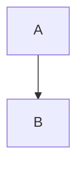

# Heading

> Quote with **strong** and *emphasis*.

- [x] done
- plain

1. ordered

---

| Left | Right |
| --- | --- |
| cell | body |

```rust title="Example" line-numbers
fn main() {}
```



```abc
X:1
K:C
C
```

```math
x^2
```

:::tip[Title]
inside
:::

::::tabs
:::tab[First]
one
:::
::::

:::details[Summary]
inside
:::

https://youtu.be/dQw4w9WgXcQ
